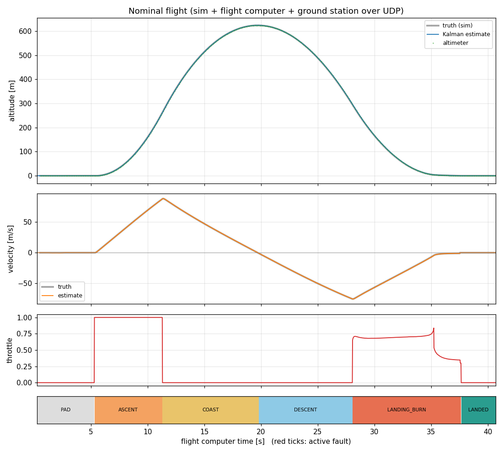
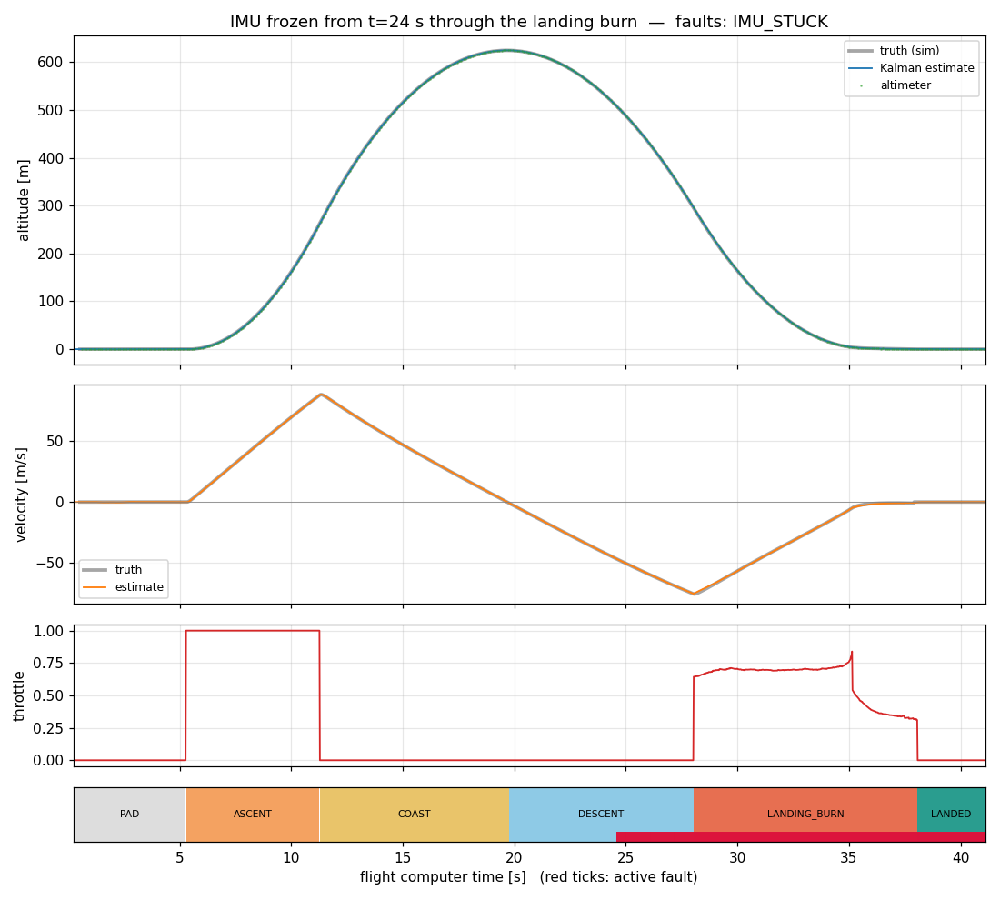

# Propulsive-Landing Flight Computer

A C++20 flight computer that flies a simulated vertical-landing rocket ("hopper"),
streams CRC-checked telemetry to a Python ground station over UDP, takes
acknowledged commands back, and detects and survives injected sensor faults.

Three Linux processes, the same split as real flight software: plant, avionics, ground.

```
 ┌──────────────── fc_sim (C++) ────────────────┐        ┌──────── flight_computer (C++20) ────────┐        ┌──── ground_station.py ────┐
 │ 1 kHz 1-D physics: thrust + engine lag,      │ sensor │ 100 Hz absolute-deadline loop            │  tlm   │ live plots (matplotlib)   │
 │ mass depletion, drag, gravity, ground contact│ ─────► │  KF: [h, v, accel bias] (IMU + alt)      │ ─────► │ seq-gap + CRC accounting  │
 │ IMU 100 Hz (delta-v, bias, noise)            │ :5500  │  state machine PAD→…→LANDED / ABORT      │ :5600  │                           │
 │ altimeter 20 Hz, fault injection             │ ◄───── │  landing-burn guidance + throttle ctrl   │ ◄────► │ stop-and-wait ARQ uplink  │
 └──────────────────────────────────────────────┘ :5501  │  fault monitor, cmd dedup, flight log    │ :5601  │ ARM / ABORT / SET_PARAM   │
                                               actuator  └──────────────────────────────────────────┘ cmd+ACK └───────────────────────────┘
```



*A real three-process run: the sim's ground truth (grey) under the flight computer's
Kalman estimate, the throttle profile of the ascent burn and the hover-slam landing
burn, and the state timeline.*

## Measured results

All numbers come from `scripts/measure.sh` (raw tables in
[docs/measurements.md](docs/measurements.md)) on Ubuntu 24.04 under **WSL2** on a
Windows 11 laptop: a virtualised kernel, not a PREEMPT_RT target. Treat the timing
figures as an upper bound for this hardware, not a flight-grade claim.

**Tests:** 88 GoogleTest cases (unit, closed-loop flights, golden-log replay), clean
under ASan + UBSan with `-Werror`, plus 13 Python tests for the ground-station
protocol and ARQ.

**Loop timing**, 100 Hz loop, 3 full flights per configuration, 37,445 frames, **0 overruns**:

| configuration | wake latency p50 / p99 | period jitter p50 / p99 | worst frame |
|---|---|---|---|
| default scheduler, 1 ns timer slack | 223–612 / 480–859 µs | 23–29 / 310–412 µs | 3.0 ms |
| SCHED_FIFO + mlockall | 78–298 / 589–911 µs | 22–35 / 363–446 µs | 2.2 ms |
| SCHED_FIFO + 500 µs hybrid spin | 0 / 102–132 µs | 0.2 / 138–210 µs | 3.5 ms |

On WSL2 the Hyper-V timer, not the scheduler, sets the floor (~250 µs p50 wake
latency with or without SCHED_FIFO). Sleeping to 500 µs before the deadline and
spinning the rest gets under it, at the cost of ~5 % of one core. Millisecond
outliers are host preemption of the VM.

**Links under 20 % `tc netem` loss** on the ground links (each direction):

| link | result |
|---|---|
| command uplink, 2000 commands | **2000/2000 delivered (100 %)**, 0 failed, 63.7 % first try (theory 0.8² = 64 %), 1.58 transmissions per command, latency p50 10 ms / p99 210 ms / max 310 ms |
| command uplink, clean | 2000/2000, latency p50 10.0 ms / p99 10.5 ms (one flight-computer frame) |
| telemetry downlink, one flight | 81.1 % delivered, all 383 drops detected from sequence gaps; the vehicle landed normally (1.06 m/s) |

**Fault injection** (real-time three-process runs; same scenarios in-process as unit tests):

| injected fault | flight computer response | outcome |
|---|---|---|
| none | — | landed, 1.05–1.07 m/s across 10 flights (incl. the netem run) |
| altimeter dropout, 6 s spanning landing-burn ignition | `ALT_STALE` → IMU dead-reckoning | landed, 1.07 m/s |
| IMU frozen from descent through touchdown | `IMU_STUCK` → thrust-model navigation + ZUPT | landed, 1.04 m/s |
| IMU frozen, then altimeter lost | nav_loss → ABORT 0.25 s after the second fault | engine cut, chute landing 6.6 m/s |
| sensor link blackout, 1 s | sensor_link → ABORT after 200 ms | engine cut, chute landing 6.6 m/s |

**Replay:** all 14 real-time flight logs from the campaign replay **bit-exact**
(`fc_replay --tol 0`) through the deterministic core, and 4 golden logs are checked
in CI.

Not covered end to end: netem `corrupt` on loopback is dropped by the kernel's UDP
checksum before it reaches the ground station, so CRC rejection of corrupt packets
is verified by unit tests (every single-bit flip of a telemetry packet, C++ and
Python), not in the netem runs.



## Requirements

| ID | Requirement | Implementation | Verified by |
|---|---|---|---|
| REQ-001 | Fixed-rate 100 Hz control loop | `rt::PeriodicTimer` on absolute `CLOCK_MONOTONIC` deadlines (no drift), overrun detection and re-anchoring; optional `SCHED_FIFO` + `mlockall` | wake latency and period jitter recorded every frame, reported p50/p99/p99.9/max (`fc_stats.json`) |
| REQ-002 | Flight state machine PAD → ASCENT → COAST → DESCENT → LANDING_BURN → LANDED, ABORT from any non-terminal state | `fc::StateMachine` (pure logic, tick-counted, no clocks) | `test_state_machine.cpp` incl. parameterised abort-from-every-state |
| REQ-003 | Fuse IMU and altimeter | 3-state Kalman filter `[h, v, accel_bias]`, IMU-driven predict, altimeter update, Joseph-form covariance, chi-square innovation gate | `test_kalman.cpp`; closed-loop nav error < 1 m |
| REQ-004 | Throttle controller for the landing burn | ignition point from stopping distance at planned throttle; velocity-profile tracker `v_ref(h) = -sqrt(2a(h-h_t)) - v_t` with feed-forward and drag compensation, clamped to engine throttle range | `test_guidance.cpp`; touchdown < 2 m/s across 10 noise seeds |
| REQ-005 | Binary telemetry with sequence number, timestamp, CRC-32 | 18-byte header (magic, version, type, seq, µs timestamp, length) + payload + CRC-32/ISO-HDLC | `test_protocol.cpp` (every single-bit flip rejected, truncation, padding, wire layout) |
| REQ-006 | Ground station detects dropped and corrupt packets | `SequenceTracker` (gaps, reorders, wraparound) + CRC check on every datagram | `ground/test_ground.py`; netem runs below |
| REQ-007 | Uplink commands acknowledged and retransmitted until ACKed | stop-and-wait ARQ: random 32-bit session, monotonically increasing `cmd_id`, RTO retransmit; flight computer executes each `cmd_id` once and re-sends the cached ACK for duplicates | `test_commands.cpp`, `test_ground.py` (simulated 20 % loss, exactly-once execution), `uplink_stress.py` under netem |
| REQ-008 | Fault: altimeter dropout | `ALT_STALE` after 250 ms without a valid reading → IMU dead-reckoning, uncertainty grows honestly | closed-loop + SITL: lands through a 6 s dropout spanning landing-burn ignition |
| REQ-009 | Fault: stuck IMU value | `IMU_STUCK` after 5 bit-identical samples → navigate on the commanded-thrust + drag model, zero-velocity update at ground contact | closed-loop + SITL: lands with the IMU frozen through the whole landing burn |
| REQ-010 | Fault: 20 % packet loss (`tc netem`) | `scripts/netem.sh` impairs only the ground links (UDP 5600/5601) on loopback | SITL flight + 2000-command uplink stress under 20 % loss |
| REQ-011 | Detect fault, degrade gracefully or abort | single nav-sensor loss → degrade; both lost, sensor link lost > 200 ms, or altitude σ > 10 m → ABORT (engine cut, chute); faults on the pad block ARM and hold the countdown | `test_state_machine.cpp`, `test_closed_loop.cpp`, SITL fault runs |
| REQ-012 | Measure loop timing, report p50/p99 jitter | per-frame wake latency + period jitter, nearest-rank percentiles | `scripts/measure.sh` → table above |
| REQ-013 | Replay mode for regression tests | every frame's inputs and outputs logged; `fc_replay` re-runs the log through `FlightComputer::step()` and diffs every output | golden-log tests in `test_replay.cpp`; every real-time SITL log replays bit-exact |
| REQ-014 | Engineering hygiene | CMake + presets, GoogleTest, ASan + UBSan preset, `-Werror` in CI, GitHub Actions (build, sanitizers, Python, SITL + netem) | `.github/workflows/ci.yml` |

## Design notes

**Deterministic core, thin executive.** `FlightComputer::step(inputs) → outputs` is
one 100 Hz frame and owns no sockets, clocks or threads. The real-time executive
(`src/fc/main.cpp`), the in-process closed loop (`sim::run_closed_loop`) and log
replay all drive the same function. That is what makes replay exact and lets
whole flights run as unit tests in milliseconds. Floating-point contraction is
disabled (`-ffp-contract=off`) so a log recorded at `-O2` replays identically at
`-O0` under the sanitizers.

**Navigation.** The IMU reports mean specific force over its sample period (a
delta-v output, like a real IMU), so ground impact is visible even between
samples. The filter subtracts gravity and its own bias estimate. The bias is
observable on the pad and converges before launch. Altimeter readings that fail a 5σ
innovation gate are rejected; after 10 consecutive rejections the filter trusts
the altimeter again rather than locking itself out. Sensor gaps are bridged on
the thrust model in sensor-period steps, with large process noise.

**Guidance.** Ignition altitude is the stopping distance at a planned 75 %
throttle (drag ignored, so conservative) plus margin. At ignition the controller latches the
deceleration that makes the reference profile pass through the current state, then
tracks it with feed-forward + proportional velocity control, computing thrust from
the estimated mass (integrated from its own throttle commands) and modelled drag.

**Uplink protocol.** Stop-and-wait keeps ordering trivial and makes "execute at
most once" a single comparison: `cmd_id ≤ last_executed` means a retransmission, and
the cached ACK is re-sent. A random session id lets a restarted ground station start
over at `cmd_id = 1`. Retransmission is on a fixed 50 ms RTO; the flight computer
answers within one 10 ms frame. Known limitation: one active ground station at a time
(a second session supersedes the first).

**Fault policy.**

| Condition | Detection | Response |
|---|---|---|
| Altimeter silent | > 250 ms since last valid reading | `ALT_STALE`: IMU dead-reckoning |
| IMU frozen | 5 bit-identical samples (a noisy MEMS IMU never repeats exactly) | `IMU_STUCK`: thrust-model navigation, ZUPT at touchdown; clears after 50 changing samples |
| Altimeter outlier | innovation > 5σ | reading rejected, `ALT_OUTLIER` for 1 s |
| Both nav sensors lost | `IMU_*` and `ALT_STALE` | ABORT (nav_loss) |
| Sensor link lost | > 200 ms without a sensor packet | ABORT (sensor_link) |
| Estimate diverged | altitude σ > 10 m | ABORT (est_diverged) |
| Any of the above on the pad | before/after ARM | ARM rejected / countdown hold |

ABORT cuts the engine and deploys the parachute.

## Build and run

Linux (tested on Ubuntu 24.04 under WSL2) with g++ ≥ 13 or clang ≥ 16:

```bash
sudo apt-get install -y cmake ninja-build libgtest-dev python3-matplotlib
cmake --preset release && cmake --build --preset release
ctest --preset release
```

Sanitizers: `cmake --preset asan && cmake --build --preset asan && ctest --preset asan`.

Fly it (three terminals, or `scripts/sitl.sh --gui`):

```bash
build/release/flight_computer --log flight.fclog --stats fc_stats.json
python3 ground/ground_station.py            # click ARM, or type: arm
build/release/fc_sim --fault alt_dropout@24:6
```

Other tools:

```bash
build/release/fc_closedloop --all                      # every scenario in-process, ~0.1 s each
build/release/fc_replay flight.fclog                   # re-run a recorded flight, diff every frame
sudo scripts/netem.sh on 20                            # 20 % loss on the ground links only
python3 ground/uplink_stress.py --count 2000           # uplink delivery / latency under loss
scripts/measure.sh out/measurements                    # the full campaign behind the numbers above
```

Ground-station console commands: `arm`, `abort`, `ping`,
`set <param> <value>` (`ascent_burn_s`, `landing_throttle`, `landing_kp`,
`terminal_velocity`, `ignition_margin_m`), `status`, `quit`.

## Resume bullets (filled from the measurements above)

- Built a C++20 flight computer running a 100 Hz control loop, Kalman-filter navigation and a landing-burn state machine against a simulated vehicle, with 88 GoogleTest cases in CI (ASan/UBSan clean).
- Designed a CRC-32-checked UDP telemetry link and an acknowledged stop-and-wait command protocol, sustaining 100 % command delivery (2000/2000, p99 latency 210 ms) under 20 % injected `tc netem` packet loss.
- Measured loop jitter at p99 210 µs (SCHED_FIFO + hybrid spin, WSL2) with 0 overruns in 37k frames, and added fault detection for altimeter dropout and stuck-IMU that still lands at < 1.1 m/s, verified through bit-exact log-replay regression tests.

## Layout

```
include/fc, src/fc      flight software core (filter, state machine, guidance, faults, commands, log, replay)
src/fc/main.cpp         real-time executive (100 Hz loop, sockets, timing statistics)
include/sim, src/sim    vehicle physics, sensor + fault models, closed loop, simulator executable
src/common              CRC-32, packet codec, UDP, real-time timer, statistics
src/tools               fc_replay, fc_closedloop
ground/                 ground station, protocol mirror, ARQ, uplink stress test, Python tests
tests/                  GoogleTest suite; tests/data holds golden flight logs
scripts/                SITL orchestration, netem, measurement campaign, plotting
```
